## Designing the space between states

Btwx is an animation and prototyping tool for product designers. It connects familiar design objects—artboards, layers, and properties—to the controls needed to make an interface move and respond.

The core workflow starts with two states. A designer creates artboards containing layers with matching names and types, adds an event, and customizes how those layers transition from one state to the other. Position, appearance, typography, and shape can all participate in the same interaction.

> The destination describes where an interaction ends. The transition describes how it feels.

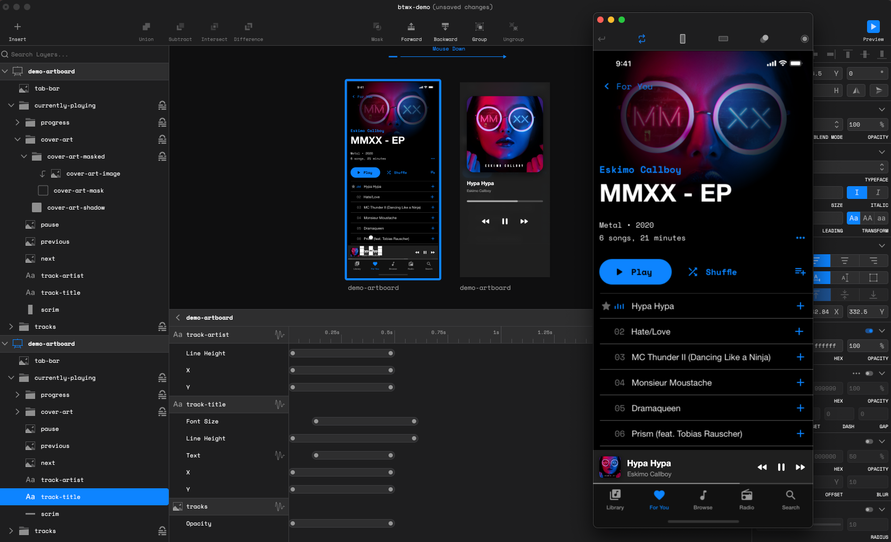

## The design problem

A static screen can communicate hierarchy, layout, and visual style. It leaves other questions open: What initiates a change? Which elements respond? Does the transition happen all at once, or in a sequence? How does it settle?

For product designers, those questions are part of the interface. A panel can move into place quickly or arrive with a softer ease. A label can change immediately or reveal its new content over time. The beginning and ending states may be identical across these variations, while the experience differs substantially.

Btwx gives that space between states an explicit editing model. Artboards define the visual endpoints; events and tweens define the behavior connecting them.

## A model built around events and tweens

The application organizes interactions at two levels. An **event** defines the relationship between a user action and a transition. A **tween** controls the change to an individual layer property within that transition.

Each event has four main properties:

- **Trigger layer:** the layer that receives the interaction.
- **Event listener:** the input that initiates it, such as a click, double click, or mouse drag.
- **Origin:** the artboard containing the starting state.
- **Destination:** the artboard containing the ending state.

Events can be added to layers other than groups. When the chosen listener fires on the trigger layer, Btwx animates layers shared between the origin and destination, matching them by name and type.

This makes layer identity part of the interaction model. A button in one artboard and its counterpart in another are connected through a shared name and type. The trigger determines when the transition begins; the matched layers determine what can animate.

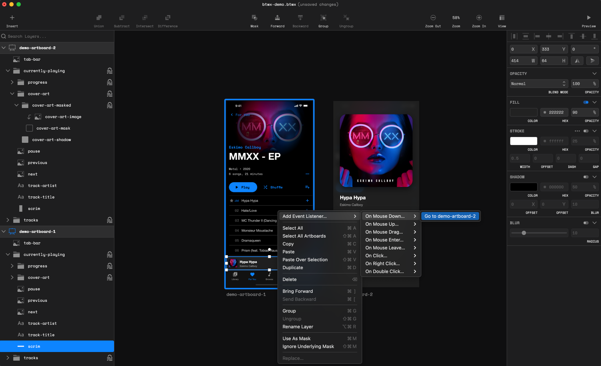

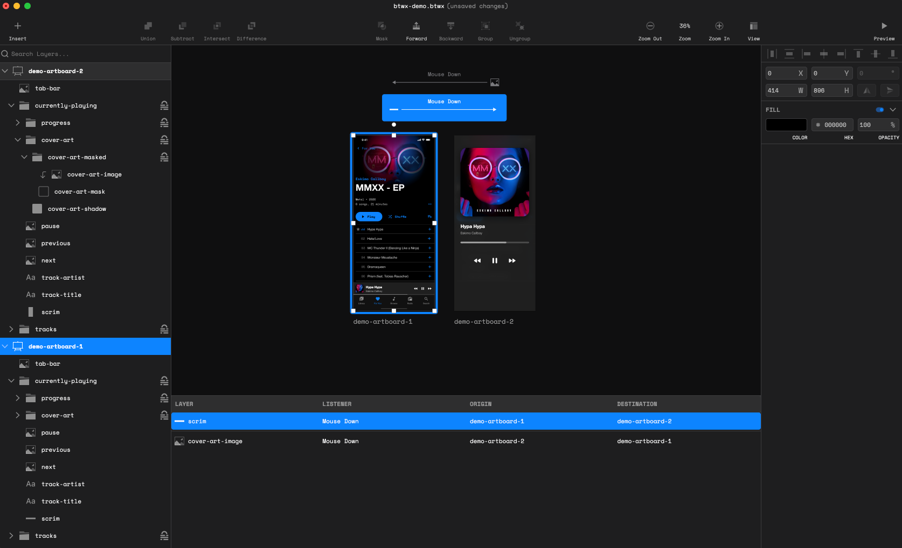

## Turning visual differences into editable motion

Once the artboards are connected, Btwx compares the properties of corresponding layers. When a property differs, the application automatically adds a tween for it.

A layer that changes position and opacity receives separate controls for those changes. Designers can then tune the transition at the property level, using options including duration, delay, ease, repeat, and repeat yoyo.

The result is a workflow with two distinct kinds of decisions. First, define the states visually. Then, decide how each difference should unfold over time.

> A change in the design becomes a starting point for motion, with each property available for further adjustment.

That separation provides room for choreography. A delay can offset one change from another. Different durations can let some properties finish sooner. Easing can change the character of a transition without changing its endpoints.

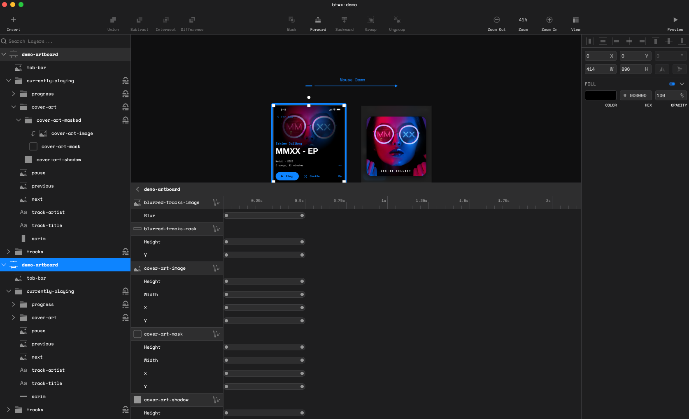

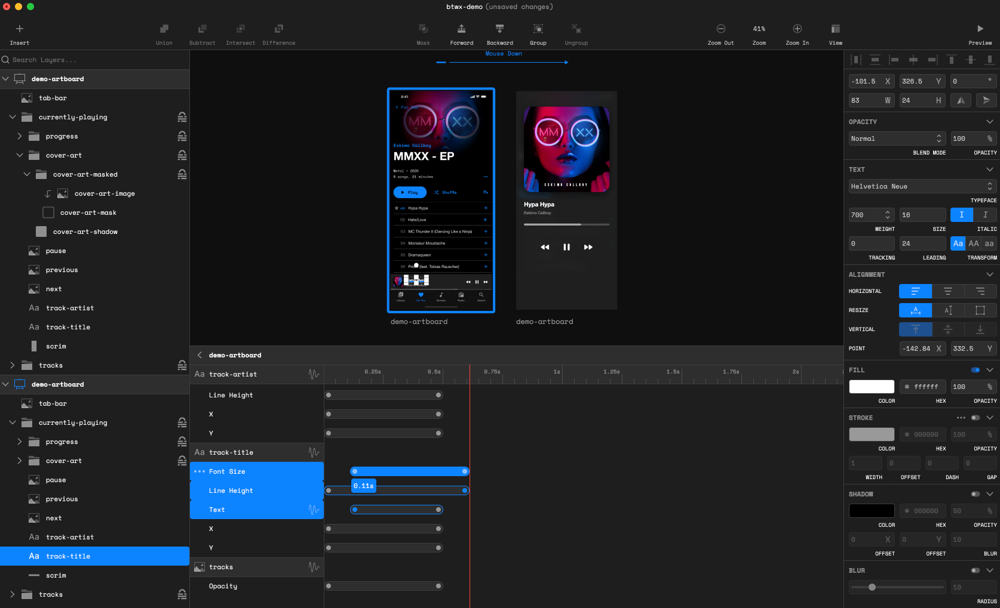

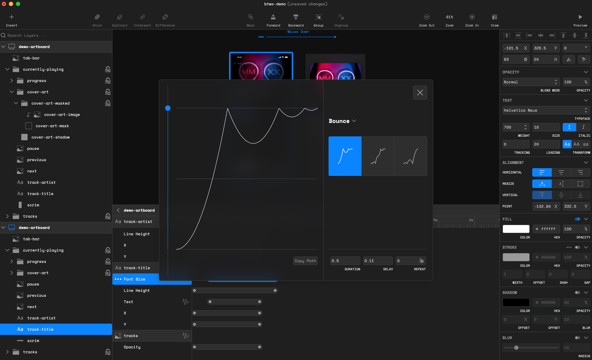

## Motion without a different destination

Not every animated property needs a different ending value. When corresponding layer properties match, Btwx allows designers to add wiggle tweens.

Wiggle tweens use the same general controls as regular tweens, with an additional strength setting. This provides a way to introduce motion to a property whose origin and destination values are otherwise unchanged.

The distinction expands what the state-based model can express. A transition can include both movement toward a new state and variation around a property that remains the same across artboards.

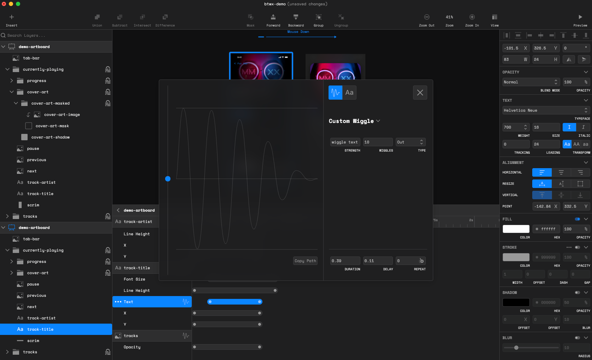

## Treating appearance and content as animatable properties

Btwx extends beyond position and size. Supported properties include rotation, horizontal and vertical scale, shape, fill, stroke, shadows, opacity, and blur. Gradient controls include origin and destination coordinates; stroke controls include width, dash offset, and dash-array width and gap.

Typography also participates in the model. Font size, font weight, letterspacing, leading, and text content can be tweened. GSAP's Text and ScrambleText plugins support text effects, while its MorphSVG plugin supports shape morphing.

This breadth lets a prototype communicate changes in visual treatment as well as movement. A transition can involve an element's geometry, its surface, and its content, with individual property controls shaping how those changes relate.

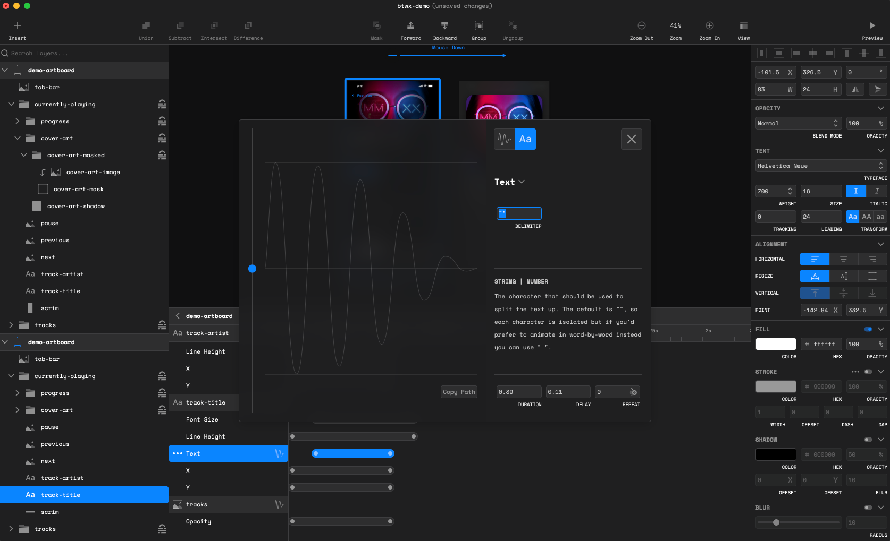

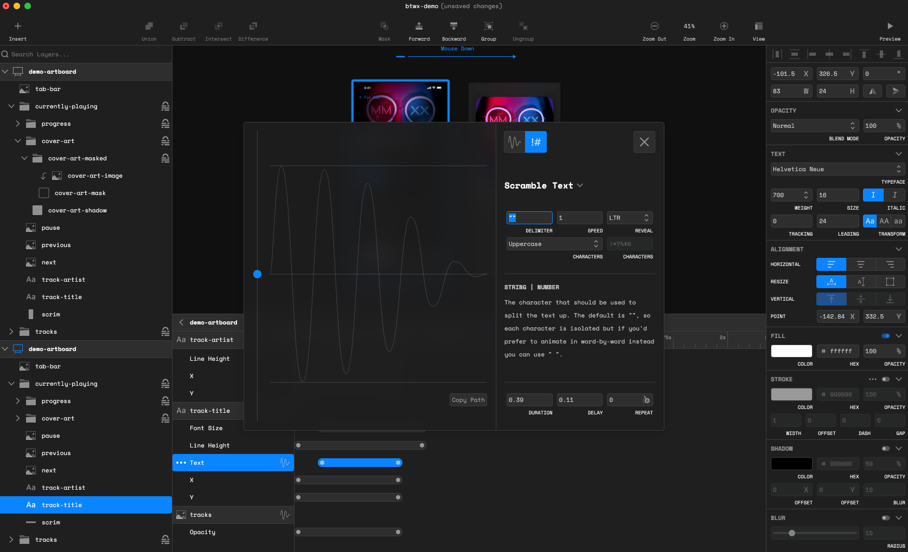

## Supporting the full prototyping loop

The animation model sits inside a broader design workspace. Basic vector editing, boolean operations, and masks support the creation of visual elements. Smart snapping and measurement support layout, while a <a href="https://github.com/madebyerik/btwx-sketch-plugin">Sketch plugin</a> provides an additional route into the workflow.

Preview lets designers inspect an interaction in motion. Device frames for iPhone, Apple Watch, and iPad provide presentation context, and screen recording makes it possible to capture the result for sharing.

These capabilities connect the main stages of the work: prepare the artwork, define behavior, inspect the result, and record it. Auto save and custom key bindings support the repeated editing that happens within that loop.

> The prototype is both an editable system of states and a behavior that can be watched, discussed, and refined.

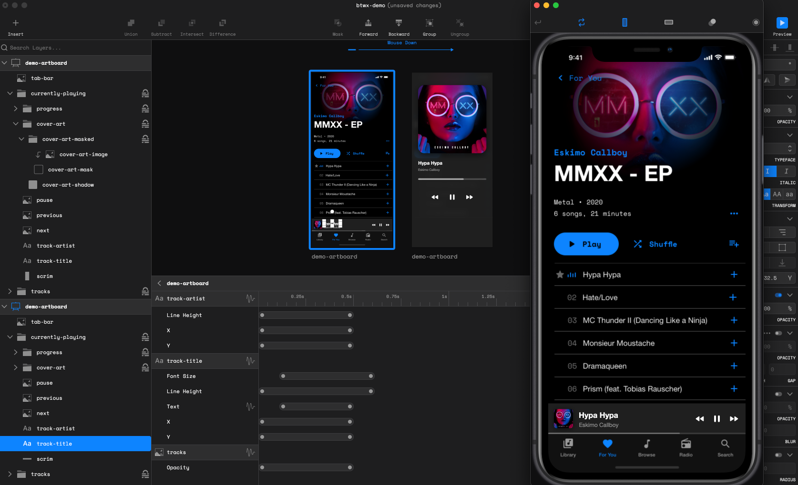

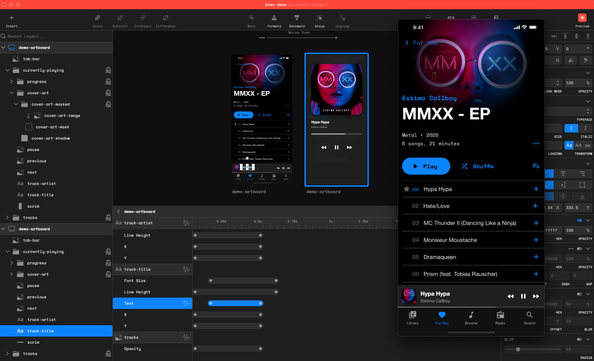

## The implementation behind the workflow

<a href="https://github.com/madebyerik/btwx">Btwx</a> is built with Electron and React, using Electron React Boilerplate. Its stack also includes GSAP and Paper.js, with GSAP plugins supporting specialized shape and text transitions.

The product brings drawing, property editing, interaction configuration, and playback into one environment. Its central design choice is the connection between visual differences and editable tweens: matching layers establishes continuity across artboards, and property differences provide the initial animation structure.

That connection is the defining idea of Btwx. Designers can begin with the states they want to communicate, then work directly on the timing and behavior that make those states feel connected.