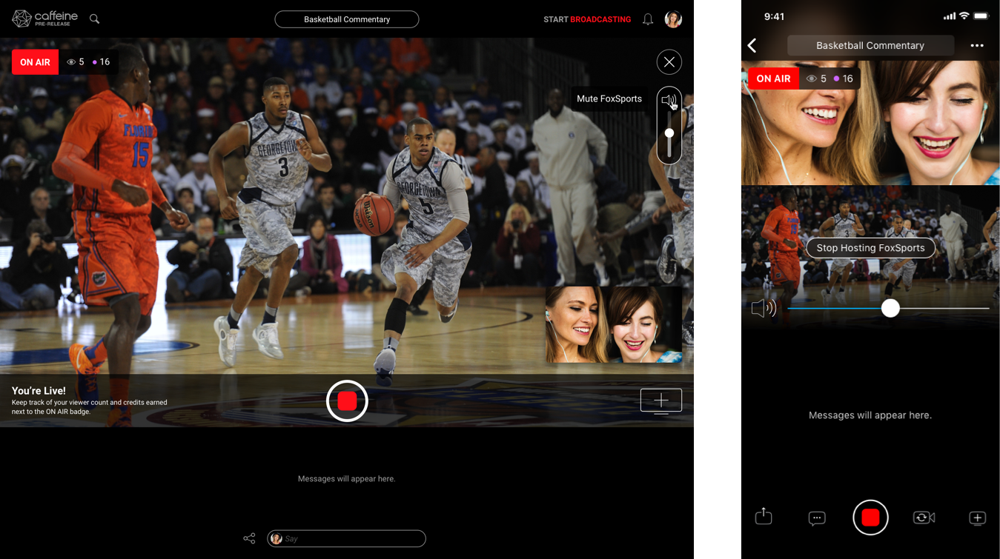
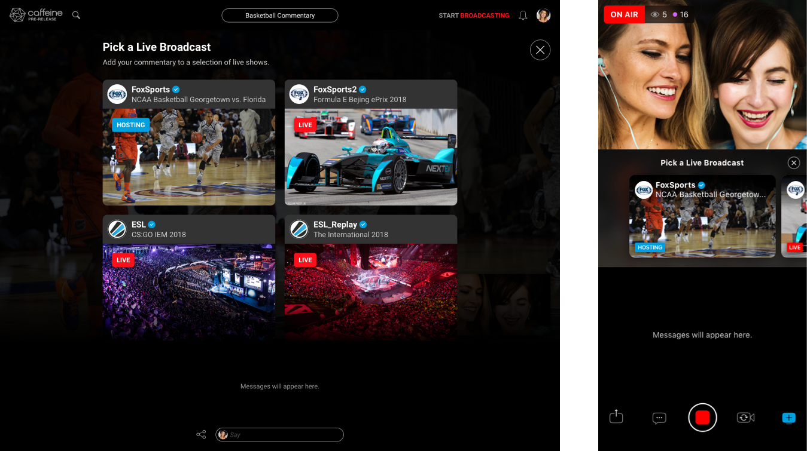
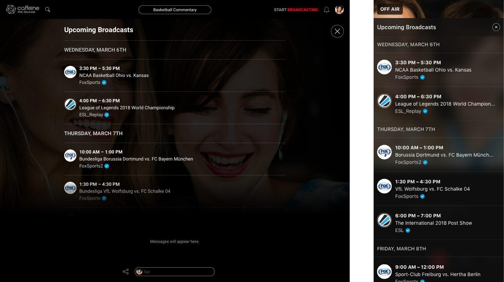

## Turning live programming into creator-led experiences

Caffeine was a social broadcasting platform built around live, real-time interaction. Initially, broadcasters on web and iOS could stream only with their webcams. An exclusive content partnership with Fox introduced premium sports and entertainment—and an opportunity to expand what creators could do on the platform.

As design lead for Live Host, I worked directly with the CEO, engineering, and design to help broadcasters bring Fox programming into their streams and add their own commentary.

> **The opportunity** \
> Give creators a meaningful role in the content—turning a live event into a show of their own.

## The challenge

The partnership brought content to Caffeine. Live Host needed to give creators a way to participate in it.

The central design question was how to bring premium programming into a broadcast while keeping the creator’s presence and perspective central to the experience.

Hosts also had to operate the interface while performing. They were following the event, reacting, and speaking to viewers simultaneously. Timing, latency, and simplicity were fundamental to making the experience work.

## Designing for real-time participation

I explored multiple interaction models for layering programming over a webcam feed, balancing expressive control with the demands of broadcasting live.

Daily engineering stand-ups kept the work grounded in real-time performance constraints. This close collaboration helped me evaluate technical feasibility as the interactions developed and work through tradeoffs quickly.

Weekly design critiques with the CEO sharpened the product direction. I presented concepts, defended decisions, and iterated based on feedback. That cadence required a clear connection between the broader vision and the details of each interaction.

> **A principle for live design** \
> An interaction has to work at the moment it matters—while the event keeps moving.

## Helping creators plan ahead

I also designed a programming guide that helped broadcasters plan future shows around upcoming content.

This extended the experience beyond the moment of going live. Creators could look ahead at programming and consider where their commentary and perspective could fit, connecting immediate participation with longer-term intent.

## What it made possible

Live Host enabled a new class of creator-driven broadcasts. Hosts could bring Fox content into their streams and contribute real-time commentary, helping unlock the creative value of the partnership.

It expanded broadcasting on Caffeine beyond webcam-only streaming and established a foundation for richer live participation.

> **The outcome** \
> The event gave people something to watch. The host gave them someone to watch it with.

## What I learned

Live Host reinforced how deeply timing shapes usability. In a live experience, even a small interaction competes with the broadcaster’s attention. Simplicity helps creators stay focused on the event and their audience.

The project also strengthened how I collaborate across disciplines. Daily work with engineering grounded the design in technical realities, while regular critiques with the CEO pushed me to articulate a clear vision and a strong rationale for every interaction.