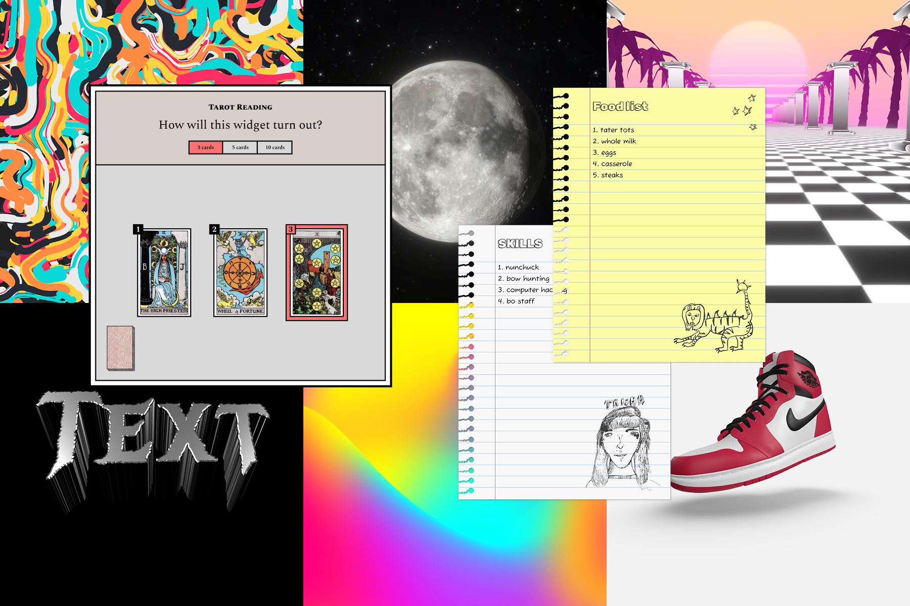
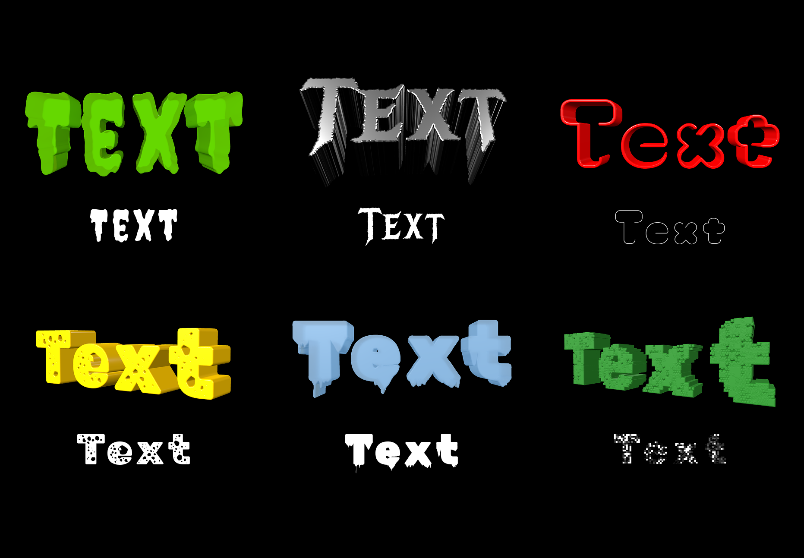
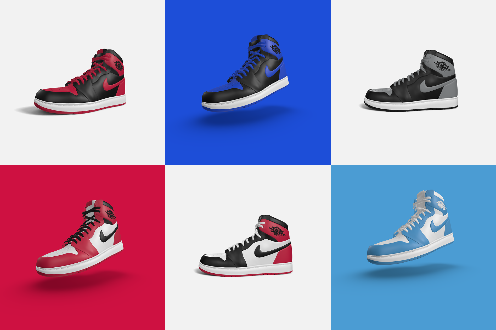
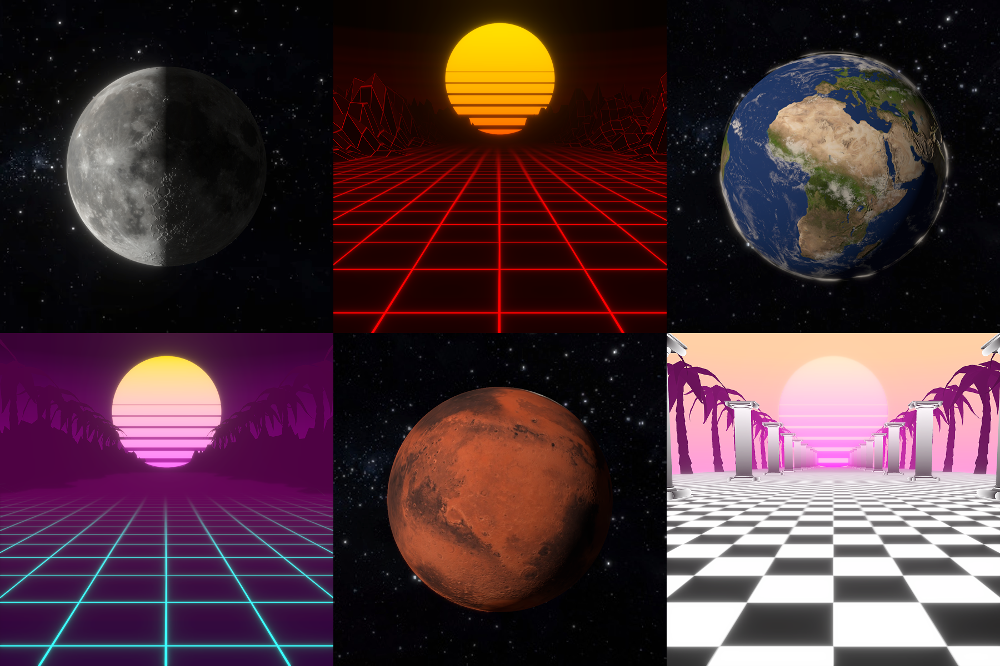
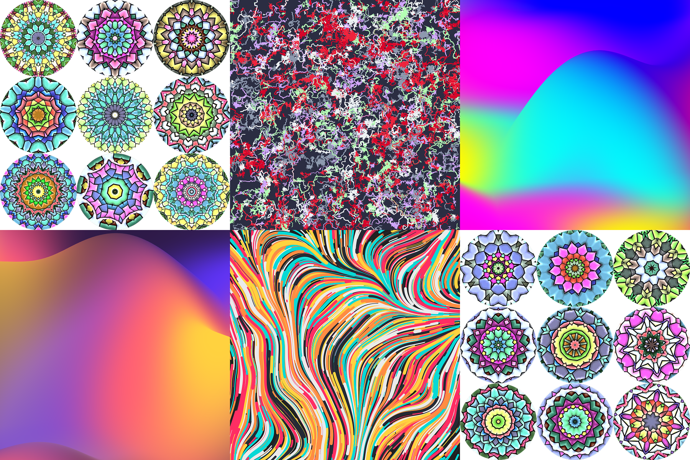
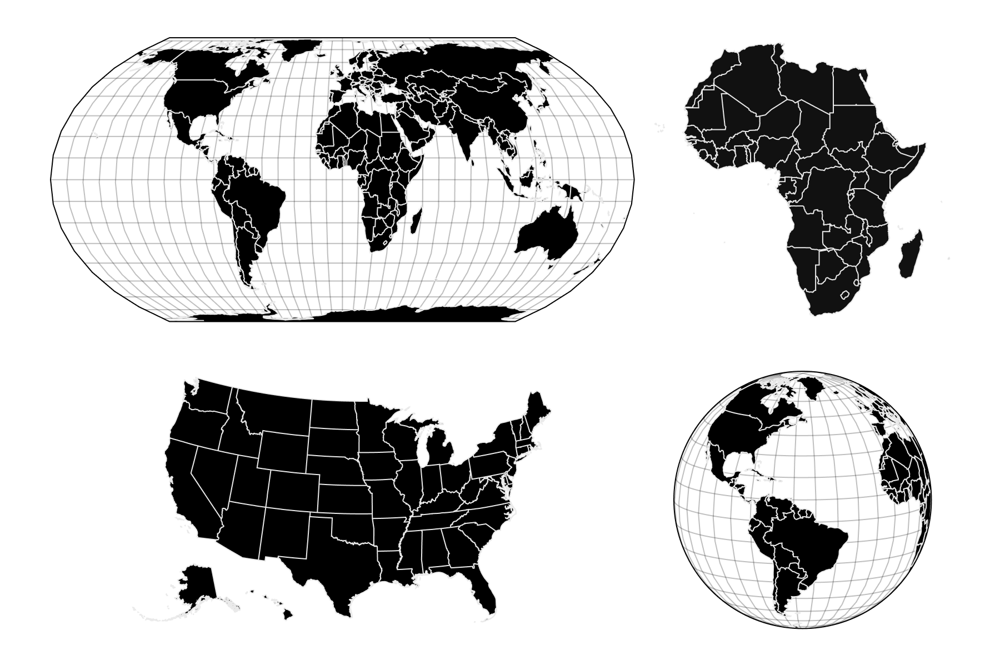
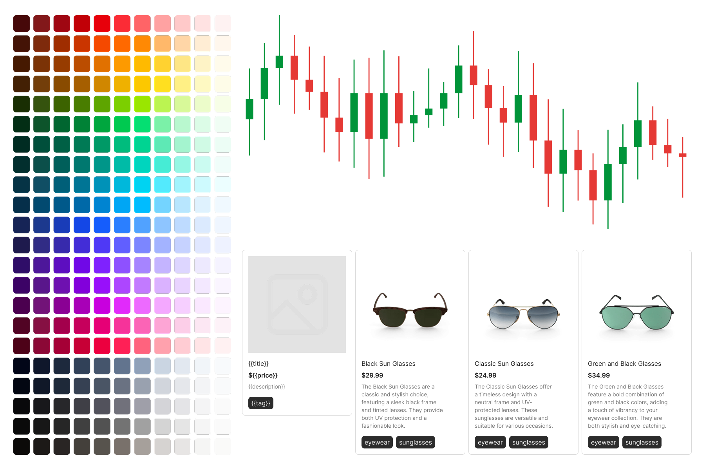
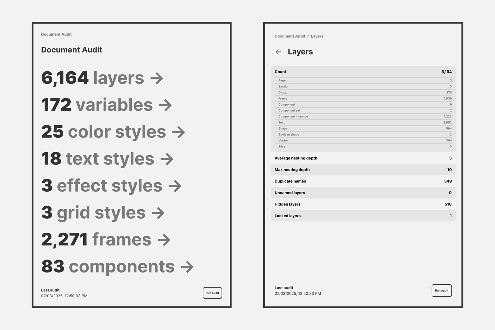
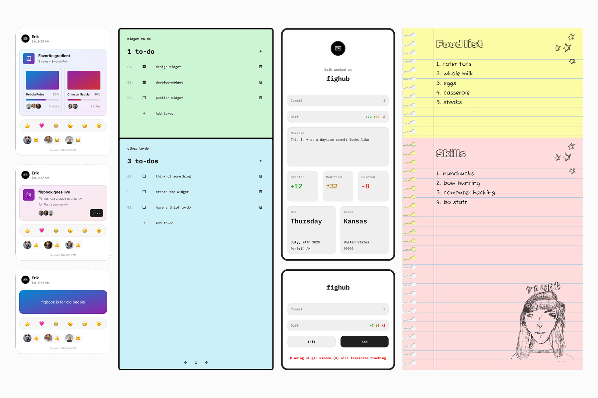
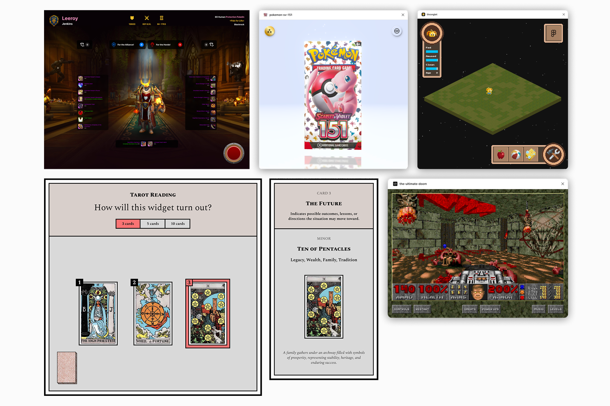

## Building tools for utility, expression, and play

My Figma work spans 27 plugins and widgets: tools for building design systems, generating artwork, working with data, and bringing a little unexpected life to the canvas. Some solve familiar production problems, like populating a layout or auditing a document. Others turn Figma into a place to open Pokémon packs, customize a sneaker, or play Doom.

Together, these projects explore a broad question: how much can a design workspace become when designers can build their own tools inside it?

The collection combines interface design with implementation across React, Three.js, React Three Fiber, p5.js, D3, and other specialized libraries. Each project brings a different kind of interaction into the same environment, from adjusting a material to inspecting document structure.

> A design tool can help you finish the work. It can also give you a reason to try something you hadn’t planned.

## A collection with two kinds of presence

Plugins and widgets provide different ways to participate in a design workflow. In this collection, plugins generally support a focused action: generate a chart, render an object, insert geographic vectors, or populate a design. Widgets give an interaction a place on the canvas: a to-do list, a social feed, a [document audit](https://www.figma.com/community/widget/1519387347885061718), or a small game.

That difference shapes the work. A generator needs to make the relationship between settings and output understandable. A canvas widget needs to communicate its purpose through the object itself, including what someone can read, change, or interact with.

The projects fall into four overlapping groups:

- **Visual creation:** 3D objects, celestial scenes, generative art, gradients, and kaleidoscopic imagery.
- **Design infrastructure:** color palettes, document styles, data population, charts, and document analysis.
- **Geographic tools:** globe, country, and United States vector generators, plus a map insertion experiment.
- **Canvas experiences:** notes, task lists, social interactions, games, collectibles, and entertainment-inspired widgets.

These groups share a recurring interaction pattern: start with something recognizable, expose a useful set of controls, and let the result become part of the design workspace.

## Making 3D a design operation

**[Make-it-3d](https://www.figma.com/community/plugin/1548298598841033242)** extrudes text, shapes, and vectors into still or animated renders, with controls for extrusion and materials. Presets such as gold, glass, and liquid provide starting points for different visual treatments.

Its central interaction begins with artwork a designer already has. A flat shape becomes the input to a process that introduces depth, surface, and motion. This connects 3D rendering to an existing design decision: the form of the original text or vector.

The presets and controls serve complementary purposes. A preset gives a designer an immediate visual direction. Extrusion and material controls provide room to move beyond that starting point. Built with React and Three.js, the plugin packages a rendering workflow around familiar source material.

> The useful bridge into 3D is the artwork already on the canvas.

**[Air Jordan 1](https://www.figma.com/community/plugin/1551995295127164434)** applies a more focused approach to 3D customization. Built with React Three Fiber, it centers on a recognizable sneaker model, with classic presets, flat or hover presentation, background color customization, and image and video export.

Here, the object stays familiar while its presentation changes. Presets provide a starting appearance; the presentation and background controls determine how the sneaker sits within a composition. Image and video export let that composition become a still asset or a moving one.

## Turning scenes into configurable systems

Several projects extend the rendering work from an individual object to a complete visual environment.

**[Synthwave Runner](https://www.figma.com/community/plugin/1545412297481867594)** creates animated 3D synthwave scenes with neon grids, glowing suns, fog, palms, and pillars. Built with React and Three.js, it supports high-resolution 1200 × 1200 PNG exports and loopable WebM animations.

The scene vocabulary gives the interface a clear visual identity. Each control contributes to an atmosphere: the grid establishes depth, fog changes visibility, and palms or pillars structure the space. Still and animated export support different uses of the same scene.

**[Moon Phases](https://www.figma.com/community/plugin/1544316965816319583)**, focuses that configurability on animated and still lunar renders. Phase, tilt, and glow controls let designers vary both the moon’s appearance and its presentation. The implementation uses React, Three.js, and Three.js postprocessing.

**[Planets](https://www.figma.com/community/plugin/1541055733851197486)** broadens the subject to 21 celestial models, with lighting, rotation, tilt, elevation, and atmosphere controls. Built with React and Three.js, the model collection supplies variety, while the shared controls support a consistent way to compose different celestial subjects.

Across these tools, the interface exposes the parts of a scene that directly influence the image. A designer can work through light, orientation, atmosphere, and composition using a bounded set of choices.

## Generative imagery with different starting points

Three more plugins explore image creation through systems and transformations.

**[Flow-field](https://www.figma.com/community/plugin/1539673084873861127)** generates static and animated flow fields using React and p5.js. It brings a generative art process into the design workflow. The output is a composition produced through a system of motion and marks.

**[Fancy-gradient](https://www.figma.com/community/plugin/1538977604702923026)**, built with React, generates animated and still mesh gradients. Its subject is abstract color and transition, producing imagery that can support a composition as a background or become its main visual element.

**[Kaleidoscope](https://www.figma.com/community/plugin/1537795176771571920)**, also built with React, transforms selected layers into [kaleidoscope](https://www.figma.com/community/plugin/1537795176771571920) stills and videos. Because the input comes from selected artwork, the effect can retain a visible connection to the designer’s original colors and forms while reorganizing them into a new pattern.

These projects offer three different entry points: generate a field, compose a gradient, or transform existing artwork. Together, they show how procedural tools can support both discovery and intentional reuse.

## Geographic information as editable artwork

The geographic plugins translate structured geographic data into vectors designers can use in a composition. All three are built with React, D3, and TopoJSON.

**[Geo-globe](https://www.figma.com/community/plugin/1537088302250187086)** generates globe vectors in 14 projections, with optional countries, graticules, and outlines. Projection is a central design choice here: it determines how the globe is represented, while the optional layers control the amount of geographic detail in the result.

**[Geo-country](https://www.figma.com/community/plugin/1535257934565097912)** generates Mercator projection vectors for every continent and country. It provides a more geographically focused route into the same general task: getting the relevant region into a design as vector artwork.

**[Geo-usa](https://www.figma.com/community/plugin/1536332734310839855)**, supports Mercator and Albers USA projections, from the national outline down to individual counties. Its range of geographic detail supports compositions at different scales, from a national overview to a local area.

> The map becomes part of the composition, with its projection and level of detail made explicit.

**[Add-a-map](https://github.com/madebyerik/add-a-map)** explores another route: inserting customizable static satellite and road maps through the Google Maps API. Built with React, the project remains an experiment because I chose not to fund the API costs. It belongs in this collection as an implementation experiment whose distribution was constrained by ongoing service costs.

## Supporting the everyday work of design

The utility projects focus on recurring tasks: setting up colors, bringing data into layouts, visualizing information, and understanding the structure of a document.

**[Tailwind-colors](https://www.figma.com/community/plugin/1534889312476683727)** adds the full default Tailwind CSS color palette and a curated set of multi-stop gradients as document color and paint styles. It connects a predefined palette to reusable styles inside the document.

**[UI Palette Generator](https://www.figma.com/community/plugin/1512101541165533169)** starts from a single primary color and generates light and dark UI palettes, including shades, hover states, backgrounds, and text colors. Built with React, Tailwind, and chroma.js, the tool is designed to support accessible contrast and readability across related interface colors.

The distinction between these projects is useful: one imports an established color vocabulary; the other generates a coordinated palette from a chosen starting color. Both address the work involved in turning color choices into a system that can be reused.

**[Another Data Populator](https://www.figma.com/community/plugin/1507375345145522305)**, built with React, populates designs with JSON and includes DummyJSON presets for products, carts, recipes, users, posts, comments, todos, and quotes. Filters and conditional actions provide control over how that data is applied. It connects structured content to the layouts that need to display it.

**[Simple Data Viz](https://www.figma.com/community/plugin/1522926699597225864)** generates 16 clean, customizable chart types. It addresses a related need at a different level: turning data into a visual form that can participate in a design.

## Making document structure visible

**[Document Audit](https://www.figma.com/community/widget/1519387347885061718)** is a widget for structured analysis of a Figma document. It captures statistics across layers, variables, styles, frames, and components, covering local and remote assets.

Its value comes from bringing otherwise distributed information into an inspectable summary. A design document contains both visible interface decisions and an underlying structure of assets, tokens, and metadata. The audit helps surface that structure for review.

The widget supports assessment of consistency, tokenization, and metadata completeness. That makes it relevant to maintaining a system as well as producing individual screens. The output gives designers information they can use to identify where closer inspection is needed.

> A document’s quality lives in its structure as well as its screens.

## Giving collaboration a place on the canvas

Several widgets use familiar social and productivity patterns to create shared objects within the workspace.

**[Figbook](https://www.figma.com/community/widget/1531232954323563272)** is a Facebook-inspired feed with text, status, photo, event, swatch, and poll post options. It adapts a recognizable publishing model to canvas content. The variety of post types lets the feed contain both conversational material and design-related content, such as color swatches.

**[What-to-do](https://www.figma.com/community/widget/1527650663236665460)** is a simple, stylish to-do list widget. Its scope is deliberately compact: give tasks a visible place alongside the work.

**[Fighub](https://www.figma.com/community/widget/1529088386995176266)**, brings a Git-inspired commit model into the design workflow. It supports commit messages, diffs, user data, timestamps, and location metadata. These details frame a change as a record with context: what changed, who recorded it, when it happened, and where it belongs. Its described scope is a commit-based record of design changes; claims about branching, merging, or restoration would require additional evidence.

**[Dynamite Notes](https://www.figma.com/community/widget/1567911493239780658)** adds another familiar form—a note—with a Napoleon Dynamite-inspired treatment. The utility is straightforward, while the reference gives the object a distinct personality.

## Making room for play

The entertainment projects explore what happens when the canvas supports activities beyond producing design assets.

**[Thronglet](https://www.figma.com/community/plugin/1569339488017584009)** is a Black Mirror-inspired pet simulator built with Phaser. **[Tarot Reading](https://www.figma.com/community/widget/1560660596876317143)** is a widget with three reading types. Both introduce an experience that someone can return to or interact with for its own sake.

**[Pokémon SV 151](https://www.figma.com/community/plugin/1560975419432116527)** brings pack opening and collection into a plugin built with React Three Fiber. The interaction centers on revealing and collecting, giving the experience a different rhythm from a conventional generator.

**[The Ultimate Doom](https://www.figma.com/community/plugin/1556748278573451454)** runs the complete Doom game, including levels, music, power-ups, and cheat menus, through React and js-dos. This project extends the collection into a full game experience inside the plugin environment.

**[Infinity Gauntlet](https://www.figma.com/community/widget/1505199468804605800)** takes a more mischievous approach: a Thanos-inspired widget that deletes half the layers in a document. Its action turns a familiar fictional premise into a literal operation on the canvas.

**[WoW Armory](https://github.com/madebyerik/wow-armory)** brings World of Warcraft player profiles, gear inspection, transmog ratings, and Horde or Alliance allegiance into a widget. Built with React, Express, and Puppeteer, the project remains an experiment because I chose not to fund the hosting costs. Like [Add-a-map](https://github.com/madebyerik/add-a-map), it illustrates how a project’s ongoing infrastructure requirements can influence whether it reaches an audience.

> Play is another way to explore what an interface can hold: a collection, a ritual, a character, or an entire game.

## Reach and what it tells me

As of October 20, 2026, the collection totals **15,345 users across 25 published plugins and widgets**, based on the individual project counts. The collection also includes two infrastructure-dependent experiments: [Add-a-map](https://github.com/madebyerik/add-a-map) and [WoW Armory](https://github.com/madebyerik/wow-armory). Users may overlap across projects, so the total is not a count of unique people.

The largest audiences are [Make-it-3d](https://www.figma.com/community/plugin/1548298598841033242) with **2,800 users**, [Figbook](https://www.figma.com/community/widget/1531232954323563272) with **1,800**, [What-to-do](https://www.figma.com/community/widget/1527650663236665460) with **1,600**, and [Simple Data Viz](https://www.figma.com/community/plugin/1522926699597225864) with **1,300**.

That spread includes 3D creation, social interaction, task management, and visualization. It shows adoption across several kinds of tools, from expressive generators to everyday utilities. Frequency of use, satisfaction, and time saved would need different evidence.

## What connects the work

Across the collection, the same design problem appears in different forms: how do you turn a technical capability into an interaction someone can understand and use?

For a rendering plugin, that means connecting material, lighting, and motion controls to a visible result. For a geographic tool, it means making projection and detail meaningful choices. For a [document audit](https://www.figma.com/community/widget/1519387347885061718), it means organizing structural information into something inspectable. For a widget, it means making an object on the canvas communicate what it does.

The technical range follows those needs: Three.js and React Three Fiber for 3D experiences, p5.js for generative imagery, D3 and TopoJSON for geography, Phaser for a pet simulator, and js-dos for Doom. The collection brings those capabilities into focused interfaces within a shared design environment.

This body of work represents my interest in both useful tools and expressive software. A palette generator can make a system easier to build. A globe generator can make a visual easier to create. A small pet or a familiar game can make the workspace feel different. Each project tests another possibility for what belongs on the canvas.