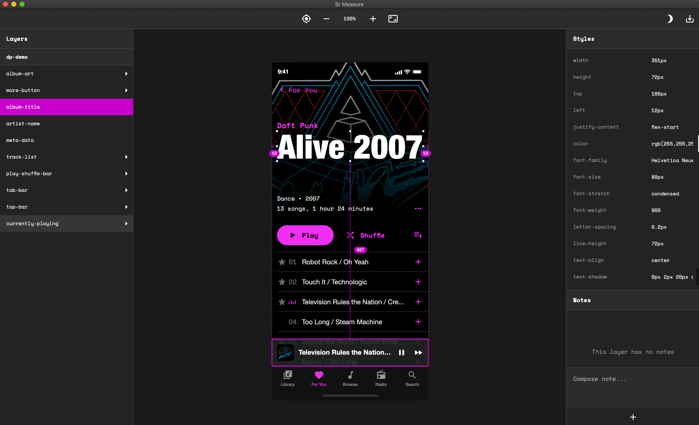
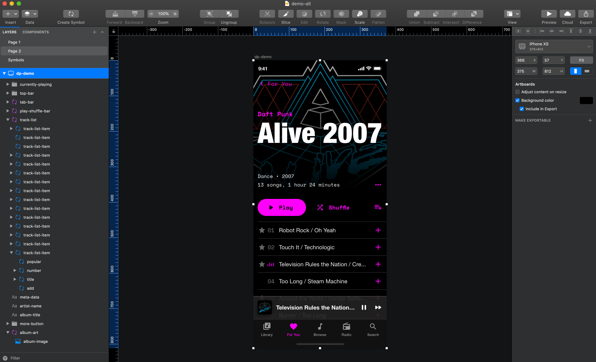
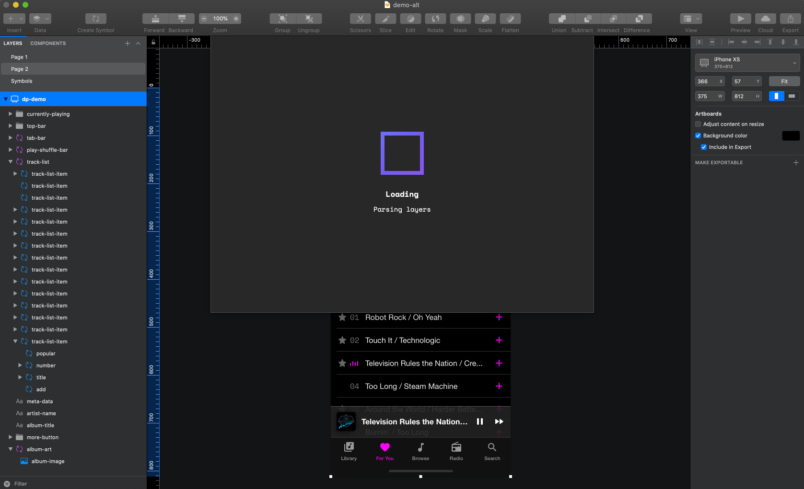
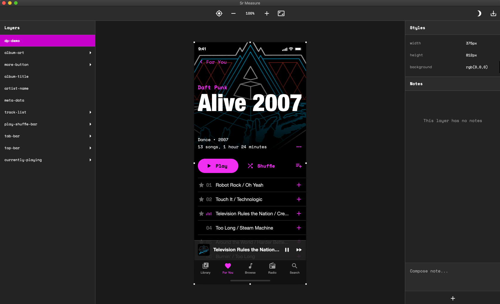
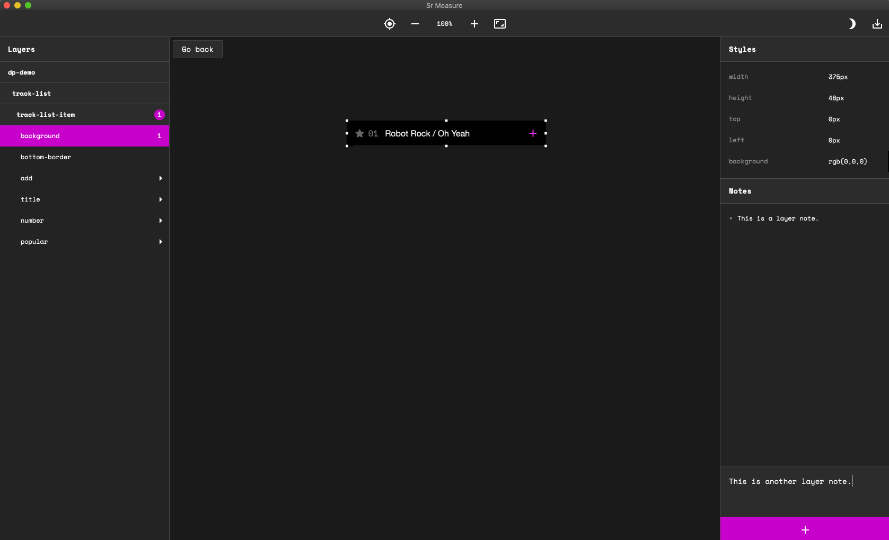
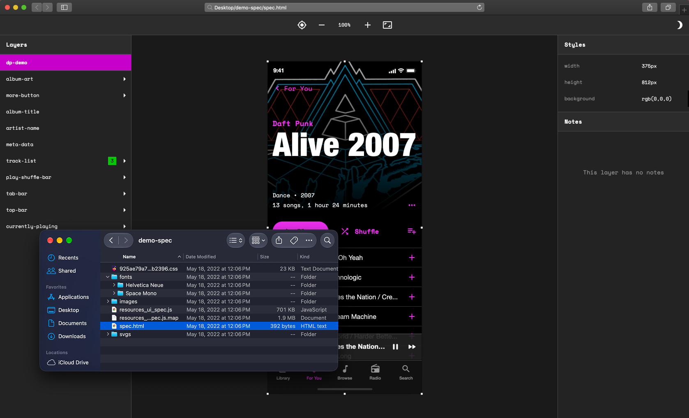

## Turning Sketch designs into browser-ready handoffs

Next is a Sketch plugin that turns an artboard into a portable HTML package, bringing design specs, CSS, assets, and designer notes into one place.

Built with React and published with skpm, it connects two working environments: the canvas where a designer defines an interface and the browser where a developer begins translating it into a product.

Created before Figma’s rise reshaped collaborative design workflows, Next explored a question that would become central to modern design tooling: how do you make a design easier for someone else to build?

> A design handoff should carry more than an image. It should carry the information needed to understand it.

## The problem: a finished design still needs explanation

A polished artboard communicates the appearance of an interface, but implementation depends on details that a screenshot cannot provide.

Developers need to understand layer structure, inspect dimensions and styles, identify fonts, and retrieve the right assets. They also need context: why an element exists, how it should behave, or which details require special attention.

Without a shared inspection workflow, those questions can turn into separate tasks. A designer exports images, writes specifications, collects assets, and answers follow-up questions. The developer pieces those materials together while building.

Next brings those parts into a single export. The design remains the visual reference, while its underlying information becomes available through a browser.

## A workflow built around one artboard

The workflow starts inside Sketch. A designer selects an artboard and opens Next. The plugin parses the artboard’s layers and converts them into HTML.

Its interface supports layer traversal and allows the designer to add notes. This gives the handoff both structure and context: developers can explore individual elements and read explanations attached to the design.

The final export is a folder containing an HTML file and the associated assets, including fonts, SVGs, and images. Opening the HTML file in a browser makes the handoff available for inspection.

1. **Select an artboard** in Sketch.
2. **Open Next** to parse its layers and generate HTML.
3. **Traverse the layers and add notes** to clarify design intent.
4. **Export the package** as an HTML file with its assets.
5. **Open it in a browser** to inspect specifications, read notes, and copy assets for production.

> Select an artboard. Export the context. Open it in a browser.

## Making the design inspectable

The central transformation in Next is from a design document into an inspectable reference.

An artboard is composed of layers, and those layers contain information that matters during implementation. Parsing that structure allows Next to expose details alongside the visual design.

Layer traversal is especially useful when an interface contains many nested elements. It gives developers a way to move through the design’s structure and locate the element they need to inspect.

This connects appearance to specification. A developer can move from seeing an element to understanding its properties, then use that information while building the production interface.

The exported HTML serves as a handoff artifact. Developers still apply their judgment to component architecture, responsive behavior, accessibility, and application logic.

## Keeping explanations close to the design

Specifications describe what is present. Notes help explain what it means.

A layer’s dimensions or CSS cannot fully communicate intended behavior, content assumptions, or an exception to a broader pattern. Next’s note feature gives designers space to supply that missing context within the handoff interface.

For example, a designer might explain that a label can wrap, that an image is temporary, or that a particular interaction needs additional implementation work. These are illustrative uses of the feature, but they show why annotation matters: some design decisions need words.

> Measurements communicate the form. Notes communicate the intent.

Placing those explanations beside an inspectable design makes them easier to interpret. The developer can connect a comment to the relevant element while reviewing its specifications.

## Packaging the assets with the specifications

Implementation also depends on having the right source material.

Next exports fonts, SVGs, and images alongside the HTML file. That makes the output a practical package: developers can inspect the design and retrieve assets from the same delivery.

The folder is the unit of handoff. Its HTML provides the inspection interface, while the accompanying files supply materials for the production build.

A useful handoff needs to help someone take the next action, whether that means checking a style, reading a note, or copying an SVG into a project.

## Building Next with React and skpm

Next was programmed with React and published with skpm.

React supported the plugin’s interface, including the experience of navigating layers and working with notes. skpm provided the tooling used to package and publish the Sketch plugin.

Conceptually, the system connects three stages:

- **Source:** the selected Sketch artboard and its layers.
- **Inspection:** a generated interface for exploring specifications and notes.
- **Delivery:** an HTML file packaged with the design’s assets.

The technical challenge is the translation between those stages. A design document needs to become something understandable outside its original authoring environment, while preserving useful relationships between the visual elements, their properties, and their assets.

That translation is what makes Next more than an asset exporter. It packages a way to explore the design.

## Before Figma’s rise and Dev Mode

Next belongs to an earlier period of design handoff, before Figma’s rise made shared, browser-based design workflows more familiar.

Its starting point was a Sketch document. Its destination was a browser. The plugin created a bridge between them by exporting the information a developer needed into a portable format.

Years later, Figma introduced Dev Mode on June 21, 2023, as a workspace designed to help developers move from design toward implementation. That provides a useful historical comparison for Next’s focus on inspection, specifications, and implementation context. [Figma’s Dev Mode announcement](https://www.figma.com/blog/introducing-dev-mode/)

The approaches differ in delivery. Next produces an exported snapshot that can be shared as a folder. Figma’s Dev Mode places developer tooling inside a shared design environment.

The connection is the underlying need: developers benefit from being able to examine a design’s structure and retrieve implementation details directly.

Next addressed that need through the tools and workflow it was built around. Its browser export made information held inside Sketch available beyond the design application.

> Next brought the handoff into the browser before that experience became an expectation of design tools.

## The tradeoff of a portable export

Exporting a folder makes the handoff self-contained, but it also creates a snapshot.

The package represents the design at the time of export. If the Sketch document changes, the handoff needs to be exported and shared again. That makes version clarity an important consideration when using this kind of workflow.

Generated HTML also has a specific role: it makes the design viewable and inspectable. Its usefulness as a reference does not establish that it is ready to serve as the production application.

These boundaries help explain Next’s value. It equips developers with information and assets while leaving the production build in their hands.

## A bridge from design to implementation

Next approached handoff as a product experience of its own.

It combined layer inspection, CSS, notes, and assets in a browser-accessible package, giving developers a practical reference for turning a Sketch design into a working interface.

Viewed today, the project reflects an early understanding of a lasting need: the work of design continues when someone else begins to build it. Next made that transition more explicit, carrying the structure and context of the artboard into the environment where implementation could begin.