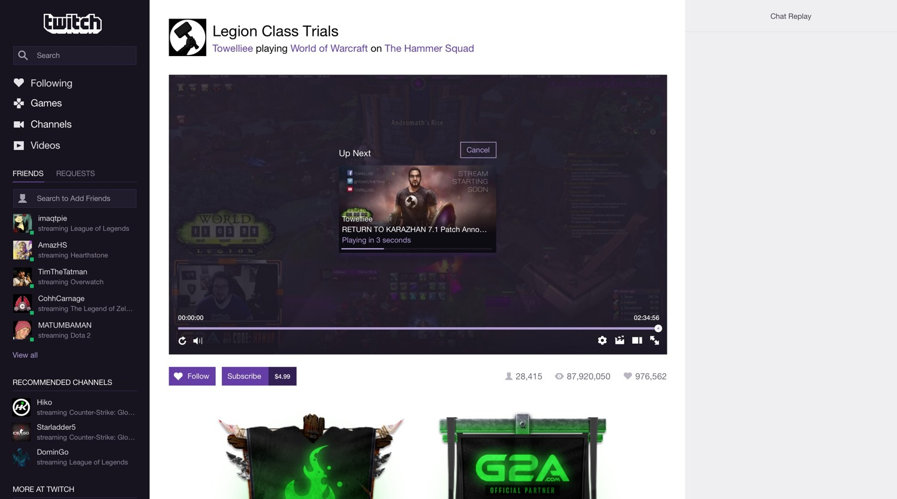
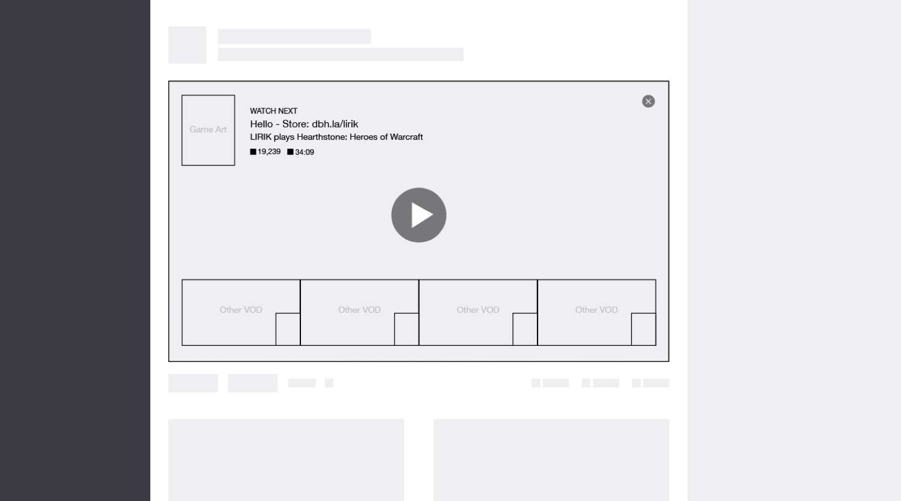
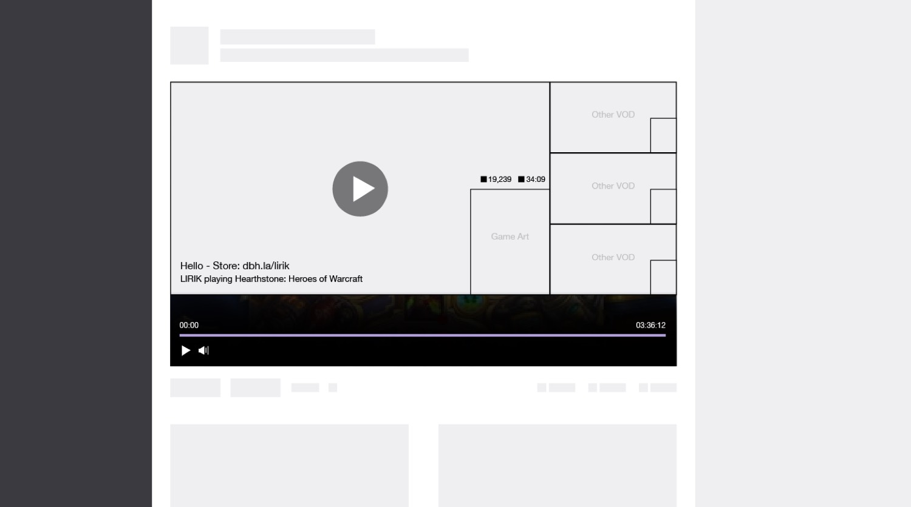
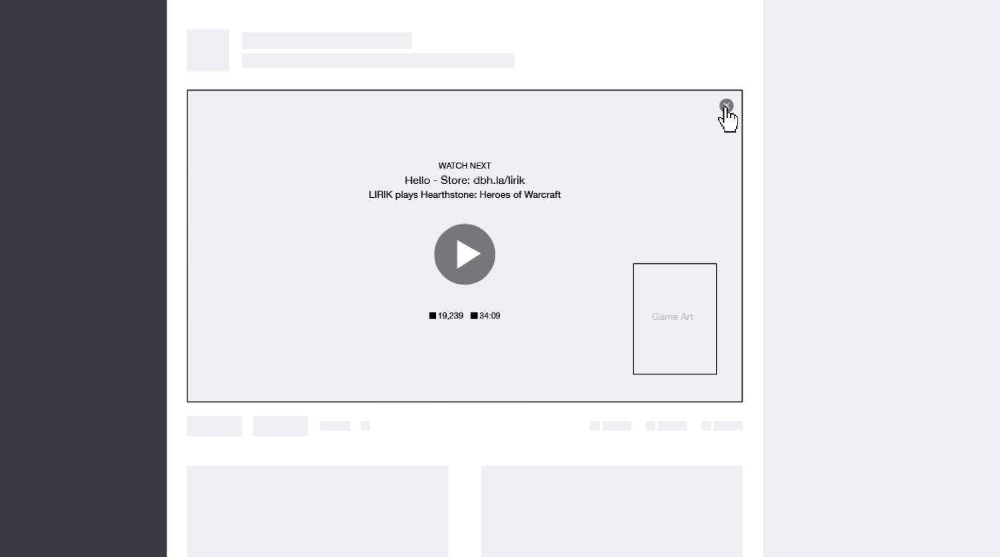
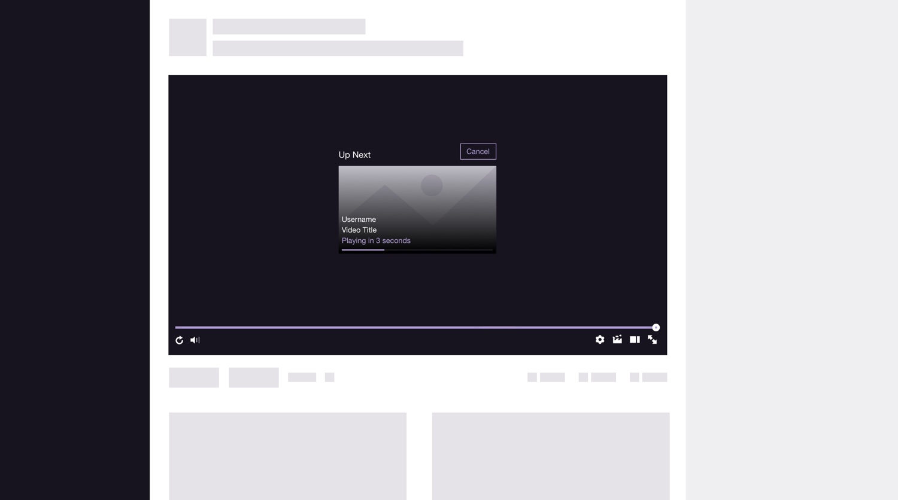
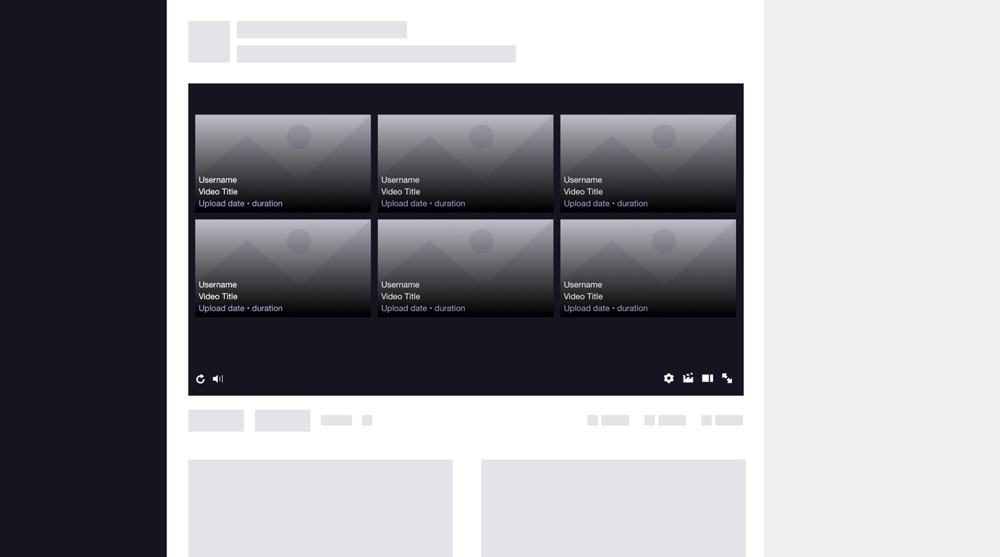
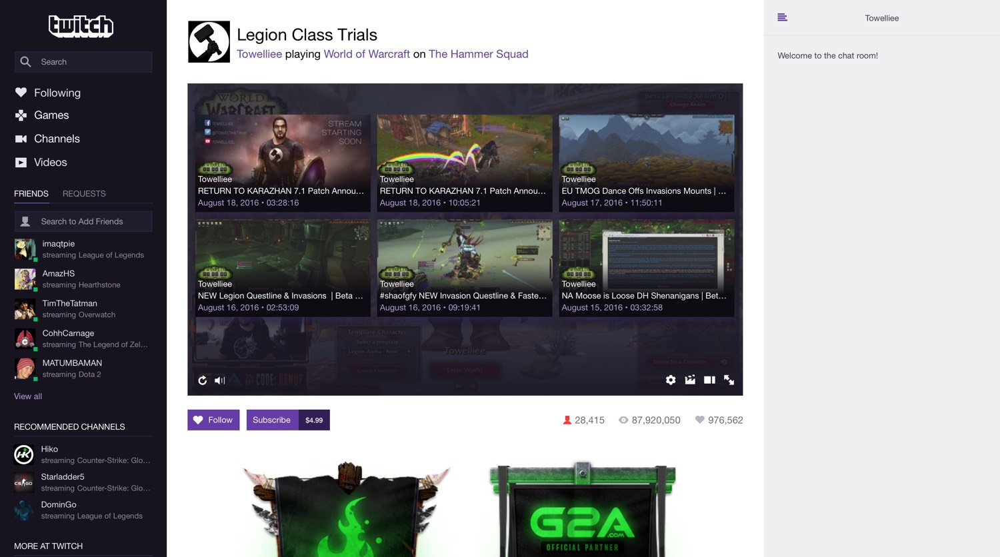

## Designing what happens when the stream ends

The end of a stream is a small moment with a significant consequence: a viewer can leave, or find something worth watching next.

As a UI/UX designer on Twitch’s Live Video team, I helped turn that moment into a new opportunity for discovery. I drove the design of Twitch’s first generation of in-player recommendations, from early concepts and interaction prototypes through responsive layouts and production CSS.

The challenge was to introduce a next step inside an experience built around watching. Recommendations needed to feel natural within the player, respect the viewer’s attention, and preserve their sense of control.

> In immersive contexts, the cost of interruption is high. You’re designing around attention, not just layout.



## My role at Twitch

I was a UI/UX designer on the Live Video team. Designers at Twitch worked as generalists, and my involvement spanned concept development, interaction design, prototyping, responsive UI, and implementation. I partnered with product, engineering, research, and data science to define the near-term experience and a longer-term direction for discovery inside the player.

## An ending without an established pattern

When a live stream or video ends, the viewing experience changes immediately. Content that held the viewer’s attention is gone, and the interface has to help them understand what comes next.

At the time, we didn’t have an existing in-player recommendation pattern to build on. We had to establish how discovery should enter this space: what it should ask of the viewer, how it should behave, and how it could support continued viewing without undermining trust.

The product goal was to support retention and session continuation. The design problem was more specific: make the transition from watching one piece of content to considering another feel coherent inside a live video environment.

That meant treating the end of playback as an interaction with its own timing, hierarchy, and behavior. A recommendation could be relevant and still feel disruptive if it appeared at the wrong moment or made the next action unclear.

## Creating clarity through exploration

I began with early explorations and concept pitches to give the team concrete directions to discuss. With no established pattern, these concepts helped make an ambiguous problem visible.

The work connected immediate design questions to a broader product direction. We needed an experience we could ship, while also considering how content discovery might become a reusable part of the player over time.

I used the explorations to examine different relationships between recommendations and the viewing experience. How prominent should discovery become after playback ends? How much initiative should the system take? What should remain in the viewer’s hands?

These questions shaped the interaction work that followed. They also gave cross-functional conversations a shared reference: an experience we could inspect, challenge, and refine together.

> Early concepts gave us something concrete to align around while the problem was still taking shape.







## Balancing continuation with control

One of the central tensions was the relationship between autoplay and user-controlled discovery.

Automatic continuation can reduce the effort required to keep watching. User-controlled discovery gives viewers an explicit opportunity to decide what comes next. Each model changes the role of the interface and the amount of attention it asks for.

I tested multiple interaction models across that spectrum. The work went beyond arranging recommendation cards: it considered how viewers would encounter the next step and understand what the system was about to do.

The design needed to support session continuation while keeping the transition legible. That made user control part of the interaction model from the beginning, alongside the goal of helping viewers discover more content.





## Prototyping the moment of transition

Static mockups could show the recommendation layout, but they couldn’t fully communicate the experience of arriving there.

I built interactive prototypes to pressure-test timing, motion, and interruption cost. These qualities mattered because recommendations were entering a space where attention had been focused on video. The transition itself was part of the design.

Prototyping let me examine the sequence as an unfolding experience: playback ends, the player changes state, and a new opportunity for discovery appears. It made questions about pacing and visual emphasis tangible in a way that isolated screens could not.

It also provided a clearer basis for discussing behavior with the team. We could consider how the experience felt over time, alongside what each state looked like.

> The transition into recommendations was part of the product, with its own demands on the viewer’s attention.

## Designing for the player’s changing dimensions

The recommendation experience had to adapt across player sizes and states. A layout that worked in one presentation could become crowded or lose its hierarchy in another.

I designed responsive layouts with those variations in mind. The task was to preserve a clear relationship between the available content and the viewer’s next action as the player changed size.

This made responsiveness an interaction concern as well as a layout concern. The amount of space available affected how recommendations could be presented and understood. The experience needed to remain coherent across those conditions.



## Following the design into production

I worked directly with engineers to validate feasibility and performance constraints as the experience developed. Those conversations kept the design connected to the realities of the video player and helped us resolve implementation questions during execution.

My involvement continued into production: I wrote the CSS for the experience.

That hands-on role let me stay close to the details of the shipped interface. Responsive behavior and visual hierarchy remained things I could help implement and refine, as well as specify. It shortened the distance between the design intent and the experience viewers received.

```css
/* Not the actual css */

.recs-wrapper { 
  display: grid; 
  grid-template-columns: repeat(3, 1fr);
  grid-template-rows: repeat(2, 1fr);
  gap: 1rem; 
}

.player-rec__title { 
  font-family: "Libre Franklin";
  font-weight: 500;
  font-size: 1rem;
  line-height: 1.25rem;
  color: #fff;
}
```

## A foundation for discovery inside the player

The work shipped as Twitch’s first in-player recommendation system. It introduced a new engagement moment at the end of streams and established a foundation for content discovery within the viewing experience.

The project also created reusable patterns for responsive, player-embedded UI. Beyond the immediate release, it helped define how another product experience could occupy the player while remaining sensitive to the context of watching.

The work directly supported retention and session continuation goals. I don’t have quantitative results to share here, so the outcome I can point to is the shipped experience and the foundation it established for subsequent discovery work.


## What I took forward

This project reinforced how much interaction design depends on context. Inside an immersive product, timing, motion, and user control have a direct bearing on whether an interface feels helpful or intrusive.

It also shaped how I approach ambiguity. Early concept work helped create clarity before the solution was settled. Staying involved through implementation helped carry that clarity into the shipped experience.

My contribution spanned both ends of that process: pitching a direction the team could evaluate, then working through the interaction details, responsive behavior, and production CSS needed to deliver it.

> Design can create clarity early—and carry it all the way through to shipping.